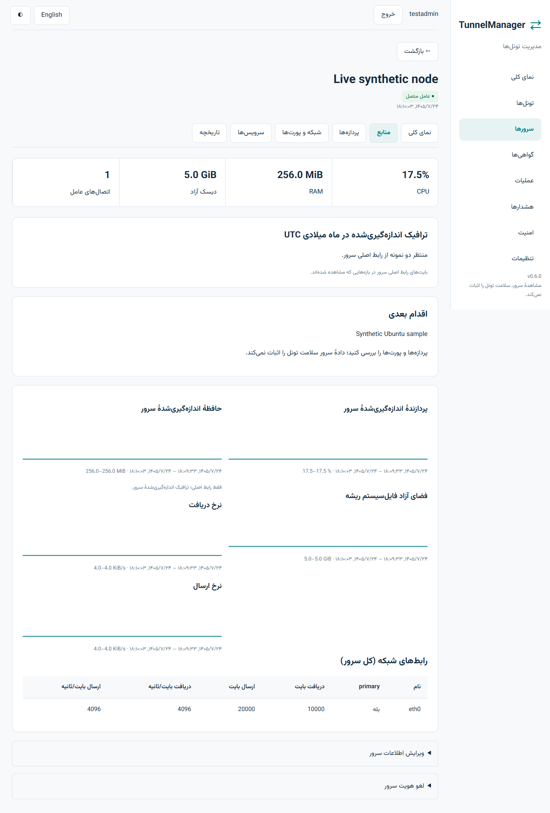

# TunnelManager
پنل مدیریت Backhaul و Rathole روی چند سرور لینوکسی.
M1 تا M3 پیاده و مستقر شده‌اند: ورود امن، نصب و نگهداری کنترلر، ثبت عامل و مشاهدهٔ واقعی منابع سرور. ایجاد و مدیریت تونل در M4 است؛ این مرحله را نسخهٔ کامل محصول حساب نمی‌کنیم.
نصب: پس از دریافت بستهٔ تأییدشده، `./tunnelmanager setup` را اجرا کنید. نصب‌کننده قبل از تغییر، خلاصهٔ برنامه را نشان می‌دهد.
پورت پیش‌فرض 9443 است. عامل از سرور به پنل وصل می‌شود و تنظیمات SSH تغییر نمی‌کند.
ورود با رمز عبور و کد برنامهٔ تأیید هویت یا کد بازیابی است؛ تأیید تلگرام اختیاری است.
وضعیت منابع مربوط به کل سرور است و سلامت کامل تونل را اثبات نمی‌کند.
[وضعیت واقعی پیاده‌سازی و آزمون‌ها](docs/PROGRESS.md).

ساخت بسته از مخزن بررسی‌شده (Node 24 و نسخهٔ Go در go.mod):
```sh
npm ci --prefix web
npm run build --prefix web
node scripts/build.mjs
sudo env TUNNELMANAGER_BINARY=./artifacts/tunnelmanager-linux-amd64 TUNNELMANAGER_CHECKSUM_FILE=./artifacts/SHA256SUMS sh install.sh setup --with-local-node
```
نصب‌کننده checksum را بررسی می‌کند؛ نصب Docker فقط با انتخاب صریح انجام می‌شود. برای arm64 فایل هم‌نام آن معماری را انتخاب کنید. هنوز انتشار نسخهٔ دارای tag انجام نشده است.

پس از ورود اولیه، TOTP را در برنامهٔ تأیید هویت ثبت و کدهای بازیابی را خصوصی نگه دارید. سپس در «سرورها»، عامل تأییدشدهٔ میزبان کنترلر را بررسی کنید. برای سرور تازه، توکن ده‌دقیقه‌ای بسازید؛ پس از انتقال بستهٔ تأییدشده و اجرای دستور، اثر انگشت را مقایسه کنید و هویت را تأیید کنید.

آزمون واقعی نصب، اجرای مجدد، بکاپ/بازیابی و بازگشت پس از خطا روی Ubuntu 22.04/24.04 و Debian 12 پاس شده است. مرورگر فارسی/انگلیسی و موبایل بررسی شده‌اند. تلگرام واقعی، ACME/DNS واقعی، Debian 11 و اجرای بومی ARM64 آزمایش‌نشده‌اند.

[گزارش معیارها و محدودیت‌ها](docs/M1-M3-REPORT.md) · [راهنمای نصب و نگهداری](docs/INSTALL.md)

تصویر مرورگر با دادهٔ نمونهٔ واضح:

