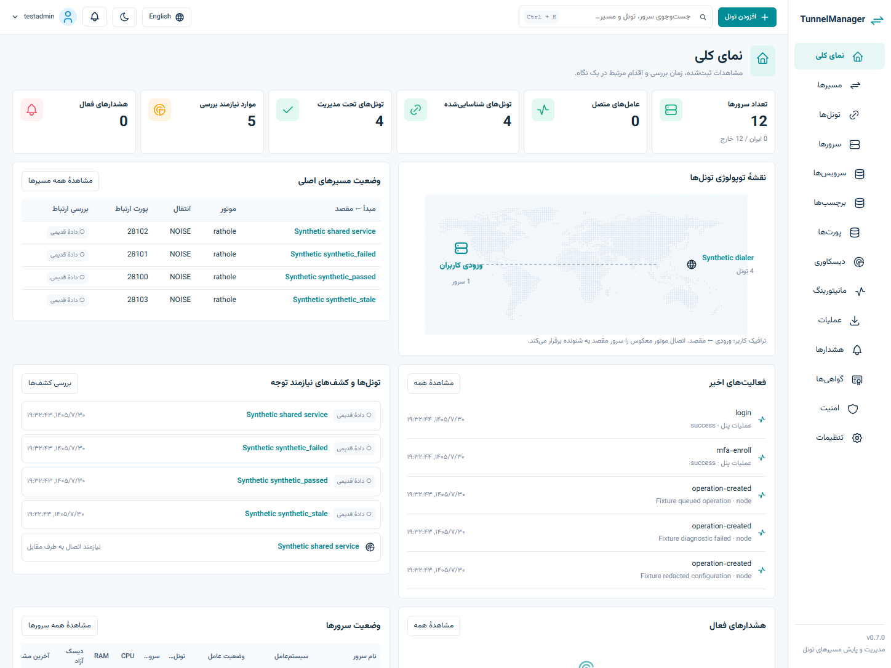

# TunnelManager
Self-hosted Backhaul/Rathole operations across Linux servers. Go + PostgreSQL + React/TypeScript; Persian RTL/English, light/dark themes. Native agents initiate verified outbound TLS connections. Tunnels continue without the controller.

[فارسی](README.fa.md) · [Operations](docs/OPERATIONS.md) · [Acceptance evidence](docs/REQUIREMENTS.md) · [Progress](docs/PROGRESS.md)

## Install
Ubuntu 22.04/24.04 and Debian 12 have native installer tests. Linux amd64/arm64 binaries are built; native ARM64 and Debian 11 remain untested. Download, inspect, then execute:
```sh
curl --proto '=https' --tlsv1.2 -fsSLo install.sh https://raw.githubusercontent.com/itsHesamHoseini/TunnelManager/main/install.sh
less install.sh
sudo sh install.sh setup --with-local-node
```
The bootstrap verifies SHA256. The wizard previews changes, domain/IP, port (9443), TLS and account setup. Docker installation is explicit. Enroll TOTP personally and save recovery codes. [v0.7.0 downloads](https://github.com/itsHesamHoseini/TunnelManager/releases/tag/v0.7.0) are published and bootstrap-tested. See [console qualification](docs/CONSOLE-0.7-REPORT.md) and [release limits](docs/RELEASE-NOTES.md). To build a reviewed checkout:
```sh
npm ci --prefix web
npm run build --prefix web
node scripts/build.mjs
sudo env TUNNELMANAGER_BINARY=./artifacts/tunnelmanager-linux-amd64 TUNNELMANAGER_CHECKSUM_FILE=./artifacts/SHA256SUMS sh install.sh setup --with-local-node
```
Build machine: Node 24, Go 1.27.3. Target: static binary and systemd; controller uses Docker/Compose. Default runtime paths: /opt/tunnelmanager, /etc/tunnelmanager, /var/lib/tunnelmanager. Only HTTPS is published.

## Everyday work
[Persian task guide](docs/QUICKSTART.fa.md)
- Add a node with a short-lived hidden enrollment token, then compare and approve its identity. Discover without writes; unique evidence pairs peers, and unmatched services stay actionable. Manual import creates an observation record. Explicit adoption is required before changes.
- Install a checksum-pinned official engine. Create/edit a tunnel with independent user entry, transport listener/dialer and backend endpoints. Preview redacted current/proposed configs, shared-route impact, port conflicts and drift.
- Both nodes prepare backups and independent local rollback timers before activation. Check the actual path and explicitly confirm within 90 seconds, or revert. Configuration edits preserve intentional stops.
- Inspect/clone/restore versions; start, stop, restart, disable, remove owned instances or revoke management while preserving files/services. Batch actions execute each distinct shared instance once.
- Read bounded redacted logs, enable temporary detailed logging with local restoration, and run node-sourced TCP/TLS/HTTP/echo/ping or explicitly bounded speed samples. The connectivity matrix covers known transport endpoints, not an invented full mesh.
- Upload, self-sign or issue ACME DNS-01 certificates with a scoped Cloudflare token. Deploy identity to listeners and public trust to peers; linked rotation has drift checks, backups and local rollback. Automatic issuance/deployment are separate policies.
- Set sustained per-service recovery thresholds, cooldown and daily ceilings. Intentional stops persist; no host reboot. Monitor fresh measured history (7/30/90 days), configurable alerts/suppression and optional expiring confirmed Telegram operations.

## Security and limits
Password + mandatory TOTP/recovery, hashed sessions, origin checks, edge/application limits, encrypted durable jobs/secrets and a master key outside PostgreSQL. Agents accept typed bounded actions only; no shell/web terminal. This outbound-agent architecture does not use or modify SSH.

Unsupported versions, mappings and identity/proxy semantics remain visible/read-only with a reason. Backhaul 0.7.2 WSS encrypts but does not verify peer certificate identity: explicit acknowledgement is required. Independent panel TLS probes are stricter and do not change engine behavior. Rathole Noise uses a selected peer key; TLS uses explicit certificate trust.

Counters describe the observed host interface, not per-tunnel usage or complete billing. Missing observations are not fabricated. VLESS application health stays unconfigured without a matching application check; TCP success is insufficient. No application users/inbounds/subscriptions are managed. Live CA/DNS/Telegram provider delivery is untested without owner accounts.

## Development and evidence
```sh
npm ci --prefix web && npm run build --prefix web
go test -p 1 ./...
go vet ./...
node scripts/neutrality.mjs && node scripts/secrets.mjs
```
Set TEST_DATABASE_URL to isolated PostgreSQL for integration tests; TUNNELMANAGER_BROWSER_TESTS=1 enables real Chrome fixtures. Native CI uses disposable Linux/systemd peers and actual engines, including failure paths; never production faults. The acceptance register distinguishes native, browser, fixture and untested evidence.



## Architecture and credits
One Go executable embeds UI and installer. PostgreSQL holds authority/history/jobs; bounded workers and native agents avoid a separate queue/collector. CSS tokens and small React components preserve the calm visual system without a component/chart framework. The terminal wizard supports masked inputs, Persian/English and NO_COLOR without a TUI dependency.

[Backhaul](https://github.com/Musixal/Backhaul), [Rathole](https://github.com/rathole-org/rathole) and [Vazirmatn](https://github.com/rastikerdar/vazirmatn) are independent projects. [Licenses and pinned artifact trust](docs/THIRD-PARTY.md). Project: MIT; independent engine licenses are unchanged.
