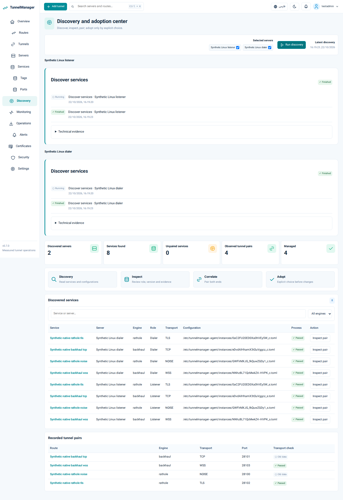
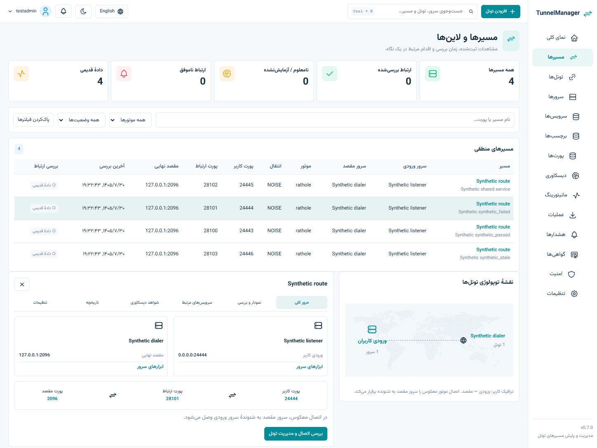

> Scope update 2026-10-23: the second engine was removed by explicit owner request. Earlier multi-engine requirements/results below are historical; they do not qualify the current Backhaul-only revision. Current acceptance: docs/REVISION-2.md.

# Console 0.7.0 delivery

Runtime/source: `cfea308749a8c6bf3b97ec26314d17fbd114b400`, Go1.27.3. Subsequent documentation/evidence commits do not change this release runtime.

## Everyday work

The accepted overview/routes/servers/discovery layouts lead to real operations. Server summaries expose measured resources, related services/listeners and tools. Global Services opens the selected instance on the intended node for configuration, logs, recovery and lifecycle actions. Route rows preserve independent user entry, transport and backend endpoints, and separate reverse connection direction from user traffic.

Selected-node discovery has per-job progress/results, bounded hostname/address correlation and unique observation-only pairs. Ambiguous/unmatched instances remain actionable through manual pairing/import. Existing infrastructure still requires explicit adoption; unsupported versions/options remain read-only with actual redacted configuration evidence. Engine installation, coordinated plans/backups/local rollback, shared/batch/lifecycle/version/clone, certificates, diagnostics, monitoring and recovery are retained. No new runtime service is added. The generated map is decorative; edges and measurements use recorded data.

## Verified effects

- [Verify39810760385](https://github.com/itsHesamHoseini/TunnelManager/actions/runs/39810760385): Go/PostgreSQL/browser/vet, dependency audits, full tracked/history scans and native installer lifecycle/failure tests.
- [Clean OS39810760542](https://github.com/itsHesamHoseini/TunnelManager/actions/runs/39810760542): Ubuntu22.04/24.04 and Debian12 native installation.
- [Native39810760229](https://github.com/itsHesamHoseini/TunnelManager/actions/runs/39810760229): engine core and full controller/PostgreSQL/browser/signed-agent/Linux/systemd workflow (full1089.75s). Actual retired engine (removed by owner) Noise/TLS and Backhaul TCP/WSS traffic; new console discovery, intended-service redacted configuration read and route application check; port editing, shared listener/two clients, clone/version/batch/lifecycle, unpaired adoption without rewriting, certificate rotation/agent-stopped local restoration, sustained recovery during controller outage, intentional stops and data-plane continuity with both agents stopped.
- [Bounded diagnostics39810760469](https://github.com/itsHesamHoseini/TunnelManager/actions/runs/39810760469): real limited network checks and negative/persistence cases.
- Fast actual Chrome fixtures deliberately repeat names across peers and between a service/linked tunnel, using the same selection helpers as native. RTL/English, keyboard/mobile, filters, drafts and empty/error/waiting/stale states are checked. `console-*-fixture-*` images are synthetic UI evidence; `console-native-*` images are actual disposable Linux engine workflows.
- The redaction regression fails on prior map-only traversal and passes recursive TOML array-table/inline-array masking while retaining non-sensitive evidence. Go1.27.3 addresses GO-2026-6809 without weakening the vulnerability gate.

## Deployment and artifacts

Own-installer controller and twelve existing agents were updated using verified binaries, an encrypted independent backup and root-only per-host evidence. Protected configuration/unit/TCP endpoint/PID comparisons pass on all twelve; master key and agent identities are retained. No existing tunnel/engine/SSH/firewall/global-DNS changes or production fault tests were performed. The private agent-specific hostname mapping is retained.

Twelve approved nodes, eleven fresh agents, thirty-seven discovered services and twelve automatically paired observation records are present, with zero managed tunnels. The remaining node's pre-existing telemetry upload timeout/retransmission blocker persists; its health is not inferred. Owner login/MFA was not impersonated. Outside-host strict HTTPS0.7.0/source, private API401 and actual Chrome Persian/English/mobile public login pass.

[v0.7.0 artifacts](https://github.com/itsHesamHoseini/TunnelManager/releases/tag/v0.7.0) and the public amd64/arm64 GHCR manifest were checked through strict HTTPS. [Release39815771686](https://github.com/itsHesamHoseini/TunnelManager/actions/runs/39815771686) retains exact-source qualification, reproducibility and actual published-bootstrap checks. Downloaded public amd64 bytes match the installed/local binary:

```text
a5716ca2f348bcf5e614c35d947e936260a5660d1d8d1d1ffbcce9ce9862330b  tunnelmanager-linux-amd64
83a47797550808eb6cb6e62566a1c45895f8b0e5d1c9c20d0547e77276400168  tunnelmanager-linux-arm64
```

Live ACME/Cloudflare/Telegram delivery, native ARM64/Debian11 and forced OS controller termination mid-mutation remain untested. The production telemetry blocker is recorded privately. HTTP/echo does not prove VLESS health. Backhaul0.7.2 WSS does not verify peer certificate identity; explicit acknowledgement remains. Unsupported configurations are not silently adopted or rewritten. Host details, credentials, original references and rollback paths remain outside public Git.




